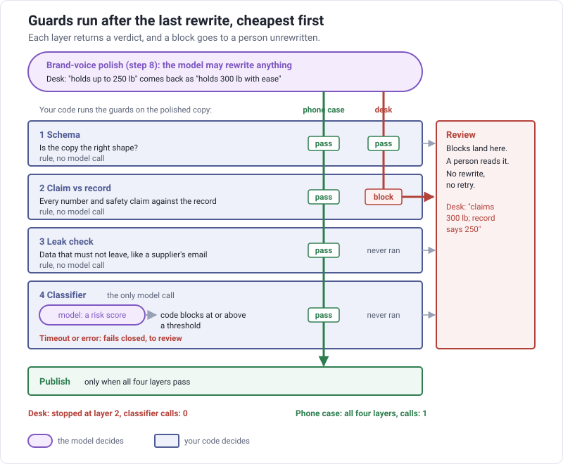

# 4.4 Guardrails & Safety

*Checks your code runs on what goes into and comes out of the model: a rule wherever your own records can settle the question, a classifier only where they cannot, placed after the last step that can change the text, with a measured cost for every block.*

*Also called: guardrails, safeguards, content filters, moderation, rails (NeMo Guardrails), validators (Guardrails AI), tripwires (OpenAI Agents SDK).*

## Why you'd reach for it

Give a style-polishing model a desk listing that says "holds up to 250 lb" and ask it to sound less robotic, and it can hand back "holds 300 lb with ease." If every check ran on the draft, nothing checked the sentence that ships. That sentence is better copy and a weight claim the product cannot meet, and on a storefront a wrong capacity is a liability and a returns problem in the same line.

That scene comes from Listing Studio, the fictional pipeline our examples use to turn a supplier's product feed into a live store listing in nine steps. Step 4 writes the copy, and step 8, the brand-voice polish (the polish, from here on), rewrites everything into one house voice just before step 9 publishes. Any step that rewrites text can reintroduce a claim an earlier check already removed.

The tempting fix is one content classifier at the end. A harm classifier is trained to spot categories like violence and harassment, and it has no idea what this desk is rated for. Asking a general model whether 300 exceeds the rating pays for a model call to do arithmetic, and it can still answer wrong. The catalog record already knows: `weight_capacity_lbs` is 250. A restricted claim worded loosely is different: no rule can read it, so it needs a model, and that is the one place to spend one.

The fix is a short stack of checks run cheapest first, after the last rewrite. Validate the shape, compare every claim the record can settle against the record, scan for data that must not leave the building, and only then ask a classifier about what is left. A failure holds the listing for a person instead of shipping it.

You need this when:

- model output reaches a customer or a downstream system without a person reading it first;
- the output can state facts your own data contradicts (capacities, certifications, prices, dates);
- the model sees data that must not reach the output (a supplier's email, a wholesale cost);
- a step after your checks can still change the text.

You do not need a separate guardrail when the output is a draft a person edits before anything ships, or when a schema alone settles validity. [2.2 Structured Output](../the-unit/structured-output.md) covers the schema, and it validates shape, never business truth.

## What it actually is

A guardrail is a check your code runs on content crossing the model boundary, on the way in (user text, retrieved text) or on the way out (the answer, before a person or another system receives it). It returns a verdict, and your code turns the verdict into one of four outcomes: pass, block, redact, or route to review. Some checks are rules your code owns: a schema, an allowlist, arithmetic against a record. Others ask a classifier model for a score that your code compares with a threshold. Neither kind steers the run or asks the model to try again.



Your code makes every decision that matters here. The rule checks are engineering you already know: OWASP's guidance on model output is to "treat the model as any other user, adopting a zero-trust approach," and to validate responses before they reach backend functions.[^owasp05] The classifier check puts a model inside the guard, but only to produce a number; the threshold, the fail direction and what a block does are all code. Structurally this is input validation from a web form, run in both directions. What is new is the source: a generator that writes fluent, plausible text, so a false claim arrives in good English with nothing malformed to catch.

Guardrails are established practice. Schema and allowlist validation and treating model output as untrusted are standard practice, and moderation classifiers for harm categories ship as free or packaged services from the major vendors. What still moves is classification against your own business policy, the framework APIs, and the false-positive cost, for which we found few independent measurements.

Four neighbours get confused with this. Where a check runs in the agent loop, and how tool calls are permitted, belongs to [2.6 The Harness](../the-unit/the-harness.md); this chapter decides what a content check concludes. A block that needs a person to decide is [4.3 Human-in-the-Loop](human-in-the-loop.md). A loop that feeds the violation back to the model for a rewrite is the [3.4 Evaluator-Optimizer](../composition/evaluator-optimizer.md), or [3.7 The Outer Loop](../composition/the-outer-loop.md) when code verifies and retries. Detecting injected instructions is [4.6 Prompt Injection](prompt-injection.md), where classifier detection is contested. If you came from [2.1 Tool Use](../the-unit/tool-use.md) or [2.4 MCP](../the-unit/mcp.md) for tool allowlisting, blast radius or server authorization, those live in 2.6.

## How to do it

Every check returns the same small result, so the reviewer reads one format and a check can be put in shadow mode (it records its verdict but blocks nothing) without changing its code.

```python
class Verdict(BaseModel):
    check: str                                   # which layer spoke
    passed: bool
    reason: str = ""                             # what the reviewer will read
    mode: Literal["enforce", "shadow"] = "enforce"

    @property
    def blocks(self) -> bool:
        # A shadow check records its finding but never holds a listing back.
        return self.mode == "enforce" and not self.passed
```

The claim check is the layer that does the most work for the least money. It reads the numbers and terms the copy asserts and compares them with the record. Three small pydantic models carry the data: `ListingCopy` holds the title and description, `Record` is a flat view of the catalog's facts about one product (such as `weight_capacity_lbs`), and `Outcome` is what the suite returns, a decision of `publish` or `review` plus every verdict.

```python
CAPACITY = re.compile(
    r"(?:holds|supports|capacity of)\s+(?:up to\s+)?(\d+)\s*(?:lb|lbs|pounds)", re.I)
SAFETY_TERMS = ("ASTM F1427", "CPSC", "child-safe")


def claim_check(copy: ListingCopy, record: Record) -> Verdict:
    text = f"{copy.title} {copy.description}"
    for n in map(int, CAPACITY.findall(text)):
        if record.weight_capacity_lbs is not None and n > record.weight_capacity_lbs:
            return Verdict(check="claim", passed=False,
                           reason=f"claims {n} lb; record says {record.weight_capacity_lbs}")
    recorded = " ".join(record.safety_claims).lower()
    for term in SAFETY_TERMS:
        if term.lower() in text.lower() and term.lower() not in recorded:
            return Verdict(check="claim", passed=False,
                           reason=f"safety claim {term!r} is not in the record")
    return Verdict(check="claim", passed=True)
```

The suite stops at the first layer that blocks, and the classifier comes last because it is the only layer that costs a model call. Its `clf` argument is the classifier client; in the repo that is `FakeClassifier`, a scripted stand-in that returns whatever risk score a test sets, shown under *Choosing the classifier*.

```python
async def run_guards(raw: dict, record: Record, clf: FakeClassifier, *,
                     threshold: float = 0.5, timeout: float = 2.0,
                     on_error: Literal["open", "closed"] = "closed",
                     shadow: frozenset[str] = frozenset()) -> Outcome:
    verdicts: list[Verdict] = []

    def settle(v: Verdict) -> bool:          # True means stop: this layer blocks
        if v.check in shadow:
            v = v.model_copy(update={"mode": "shadow"})
        verdicts.append(v)
        return v.blocks

    v, copy = schema_check(raw)
    if settle(v) or copy is None:
        return Outcome(decision="review", verdicts=verdicts)
    for check in (claim_check, leak_check):  # cheapest first, model call last
        if settle(check(copy, record)):
            return Outcome(decision="review", verdicts=verdicts)
    text = f"{copy.title}\n{copy.description}"
    v = await classify_check(text, clf, threshold=threshold, timeout=timeout,
                             on_error=on_error)
    blocked = settle(v)
    return Outcome(decision="review" if blocked else "publish", verdicts=verdicts)
```

The guard runs on what the polish returned, never on the draft it was given:

```python
async def finish_listing(draft: dict, polish: Callable[[dict], dict],
                         record: Record, clf: FakeClassifier) -> tuple[dict, Outcome]:
    polished = polish(draft)               # step 8 may rewrite anything
    outcome = await run_guards(polished, record, clf)   # so check what it returned
    return polished, outcome               # "review" means a human reads it; no rewrite here
```

<details markdown><summary>The schema and leak layers (<code>guardrails/checks.py</code>)</summary>

```python
def schema_check(raw: dict) -> tuple[Verdict, ListingCopy | None]:
    try:
        return Verdict(check="schema", passed=True), ListingCopy(**raw)
    except (ValidationError, TypeError) as e:
        return Verdict(check="schema", passed=False, reason=str(e)[:200]), None
```

```python
EMAIL = re.compile(r"[\w.+-]+@[\w-]+\.[\w.]+")
PHONE = re.compile(r"\(?\d{3}\)?[-. ]\d{3}[-. ]\d{4}")
COST = re.compile(r"(?:wholesale|cost|supplier price)\D{0,20}\$\s?\d", re.I)


def leak_check(copy: ListingCopy, record: Record) -> Verdict:
    text = f"{copy.title} {copy.description}"
    for label, pattern in (("email", EMAIL), ("phone", PHONE), ("cost", COST)):
        if pattern.search(text):
            return Verdict(check="leak", passed=False, reason=f"supplier {label} in copy")
    if record.supplier_name.lower() in text.lower():
        return Verdict(check="leak", passed=False, reason="supplier name in copy")
    return Verdict(check="leak", passed=True)
```

</details>

One run, the desk through the polish, as the companion tests assert it:

1. The draft says the frame "holds up to 250 lb." It passes schema, claim, leak and classifier, and publishes after one classifier call.
2. The polish returns "a frame that holds 300 lb with ease."
3. `finish_listing` runs the guards on the polished copy. The schema check passes it.
4. The claim check reads 300, compares it with the record's 250, and blocks with the reason "claims 300 lb; record says 250".
5. The suite returns `review` with two verdicts. The classifier was called zero times.

The other fixtures behave the same way. Bunk-bed copy that says "CPSC certified" is blocked as "safety claim 'CPSC' is not in the record", because the record lists only an ASTM F1427 guardrail-height claim. Copy carrying the supplier contact's email address is blocked by the leak check. A phone case, the product with no compliance rules, passes all four layers with one classifier call. It is the control case, because a guard that blocked everything would fail it.

> **In the companion repo.** The package is `listing-studio/guardrails/`, and `tests/test_guardrails.py` asserts each verdict, the call order and the classifier call count. The classifier is scripted, so the tests quote no latency.

### Choosing the classifier

Two kinds of classifier exist, and they answer different questions. A fixed-taxonomy endpoint scores harm categories it was trained on. OpenAI's moderation endpoint is free, its `omni-moderation-latest` model returns a score between 0 and 1 per category, and the guide says to "treat moderation scores as signals for your application's policy, not as an automatic blocking decision."[^moderation] You can call it with a sentence of your own and see a score per category within minutes, which is a quick way to feel what a threshold is.

A policy-as-input classifier takes your own rules as its prompt. Llama Guard is one;[^llamaguard] OpenAI's gpt-oss-safeguard (120b and 20b, Apache 2.0) is another, and reads a policy "provided during inference, rather than being trained into the model."[^safeguard] The lightest form is a small model call constrained to a structured verdict, which Anthropic documents as a harmlessness screen.[^anthropic] These can catch a restricted claim phrased in a way no regex anticipated. OpenAI's own caveats apply: classifiers trained on large labelled sets "can still perform better" on complex risks, and the safeguard models "can be time and compute-intensive."[^safeguard] Measure one on your own traffic before you trust it.

The scripted classifier in the repo stands in for either kind: it returns a risk score, and can be scripted to raise or to stall.

<details markdown><summary>The scripted classifier (<code>guardrails/classifier.py</code>)</summary>

```python
class FakeClassifier:
    """Stands in for a moderation or safeguard model: returns a risk score in [0, 1].

    Scripted by substring; can also raise or run past the timeout. Records its calls.
    """

    def __init__(self, scores: dict[str, float] | None = None,
                 raises: Exception | None = None, delay: float = 0.0):
        self.scores, self.raises, self.delay = scores or {}, raises, delay
        self.calls: list[str] = []

    async def score(self, text: str) -> float:
        self.calls.append(text)
        await anyio.sleep(self.delay)
        if self.raises:
            raise self.raises
        return max((s for k, s in self.scores.items() if k in text), default=0.0)
```

</details>

### When the check itself fails

A classifier is a network call. It times out, the service returns a 503, or the model declines to classify; Anthropic notes that the screening model's safety classifiers "can decline the screening request itself, so treat a response with `stop_reason: "refusal"` as a harmful verdict."[^anthropic] The guard has to decide what an error means, and that decision belongs in code, chosen per check. The listing below handles a raise and a timeout; map a refusal onto the same path yourself.

```python
async def classify_check(text: str, clf: FakeClassifier, *, threshold: float,
                         timeout: float, on_error: Literal["open", "closed"]) -> Verdict:
    try:
        with anyio.fail_after(timeout):
            risk = await clf.score(text)
    except Exception as e:  # a raise or a timeout: the policy decides, not luck
        # Closed holds the listing for a human; open lets it through, and says so.
        return Verdict(check="classifier", passed=on_error == "open",
                       reason=f"classifier {type(e).__name__}; failed {on_error}")
    return Verdict(check="classifier", passed=risk < threshold,
                   reason=f"risk {risk:.2f} against threshold {threshold:.2f}")
```

Key the choice to how hard the output is to take back. Copy bound for a storefront fails closed: on a 503 the phone case goes to `review`, with the reason "classifier RuntimeError; failed closed". A reversible internal draft can fail open, publish, and say so in the log. The suite's default is closed, so nobody gets fail-open by forgetting to choose. For how a hook in the agent loop fails, and where it runs, see [2.6](../the-unit/the-harness.md).

### Thresholds, false positives and shadow mode

A guardrail sends you two bills: the violation it misses, and the good listing it blocks. The threshold trades one for the other. The repo's labelled set has four items: two bad ones scored 0.80 and 0.45, and two good ones scored 0.30 and 0.55. A score at or above the threshold blocks. At 0.5 the guard blocks the good 0.55 (one false positive) and passes the bad 0.45 (one miss); at 0.4 it catches the 0.45 but still blocks the 0.55; at 0.9 it blocks nothing and misses both bad items. Catching the bad 0.45 needs a threshold at or below 0.45, and any such threshold also blocks the good 0.55, so no threshold gets both counts to zero, and choosing one is choosing which bill you would rather pay. The scores are scripted, so the numbers illustrate the shape. The confidence floor and default-deny branch in [3.2 Routing & Dispatch](../composition/the-router-that-isnt.md) are the same move: code thresholds a model's number.

The public figures we found for that bill come from vendors. Anthropic's Constitutional Classifiers, a jailbreak defence, reported "an absolute 0.38% increase in production-traffic refusals and a 23.7% inference overhead."[^cc] That is one system in one setting, but it shows the cost can be measured. [4.3](human-in-the-loop.md) discusses a second vendor figure for a classifier acting as approver.

So measure your own before you enforce. Run a new check in shadow mode: it records its verdict on real traffic and blocks nothing. In the repo's shadow test the claim check flags the 300 lb copy, records the failure, and the listing still publishes, because a shadow check never holds anything back. Label what it flagged (measuring a guard is [4.2 Evaluation](proving-it-works.md)), set the threshold from those counts, then switch it to enforce and keep logging every block with its reason. Shadow mode is a practitioner habit; none of the vendor documentation cited here specifies it.

### Sensitive data

A copy-writing model that sees the supplier sheet can paste the sheet's contact details into the description. The leak layer blocks on an email, a phone number, a wholesale cost or the supplier's name. The same filters belong on the way in and on tool results, before a customer's details reach a prompt or a log. LangChain's middleware offers four responses (`redact`, `mask`, `hash`, `block`)[^langchain]; this pipeline blocks, because a listing with a hole where a phone number was still needs a person. Pattern matching has limited recall, and Presidio's documentation says "there is no guarantee that Presidio will find all sensitive information."[^presidio] The stronger control sits upstream. OWASP advises limiting access to sensitive data "based on the principle of least privilege,"[^owasp02] which here means keeping the supplier's contact fields out of the copy writer's input in the first place.

### What the caller gets back

When a check trips, the caller gets a structured outcome (`review` plus the verdict and its reason) and the log gets the same. A raw exception reaching a shopper, or a listing silently dropped, is the unguarded path. Where a check runs is [2.6](../the-unit/the-harness.md)'s question, but one consequence matters here. In the OpenAI Agents SDK, output guardrails run "only for the agent that produces the final output," so text one agent hands another never reaches your claim check.[^agents-sdk]

#### Wiring it to a provider

The frameworks package this shape. LangChain ships guardrails as agent middleware;[^langchain] NeMo Guardrails expresses checks as programmable "rails", including topical rails that keep a bot on subject;[^nemo] Guardrails AI composes validators with an `on_fail` action;[^guardrails-ai] Azure AI Content Safety offers harm categories, Prompt Shields (a detector for prompt attacks) and groundedness detection (whether an answer sticks to its source material, a preview feature due to retire on 2027-04-30) as a managed service.[^azure] Each one runs your checks where it hooks in and leaves the rest to you, including what a block does next. Below, the same claim and leak checks become an OpenAI Agents SDK output guardrail, whose tripwire stops the run when a check blocks. It is compile-checked only, not run.

<details markdown><summary>OpenAI Agents SDK output guardrail (<code>guardrails/guardrails_openai_illustration.py</code>)</summary>

```python
@output_guardrail
async def copy_guardrail(ctx: RunContextWrapper, agent: Agent,
                         output: CopyOut) -> GuardrailFunctionOutput:
    copy = ListingCopy(title=output.title, description=output.description)
    verdicts = [claim_check(copy, RECORD), leak_check(copy, RECORD)]
    return GuardrailFunctionOutput(
        output_info=[v.model_dump() for v in verdicts],
        tripwire_triggered=any(v.blocks for v in verdicts))


writer = Agent(name="Copywriter", instructions="Write listing copy.",
               output_type=CopyOut, output_guardrails=[copy_guardrail])


async def write_or_hold(prompt: str):
    try:
        return (await Runner.run(writer, prompt)).final_output
    except OutputGuardrailTripwireTriggered:
        return None   # route the listing to review
```

</details>

## Gotchas

**One classifier as the whole plan.** Hackett and colleagues evaded six deployed prompt-injection and jailbreak detectors, in some instances with "up to 100% evasion success," using character injection and adversarial techniques.[^hackett] A classifier is one layer. Anything that must hold goes to enforcement in the execution path ([2.6](../the-unit/the-harness.md)) or to a person ([4.3](human-in-the-loop.md)), and the attack side is [4.6](prompt-injection.md).

**A new last step.** The polish is the last step that changes text today. A translation or a template fill added after it becomes the new last step, and the guards have to move behind it.

**Rules miss what they were not written for.** LangChain's own summary of rule checks is "fast, predictable, and cost-effective, but may miss nuanced violations."[^langchain] The repo's capacity pattern matches "holds", "supports" and "capacity of", so "rated for 300 lb" passes it. Grow the pattern from what the shadow log and the review queue show you, and keep a test per phrasing.

**A guard that errors open by accident.** A bare `except` that returns a pass, or a timeout nobody configured, turns an outage into a quiet bypass. Make the fail direction a named argument with a closed default, and test it with a classifier that raises.

**Thresholds outlive their model.** OpenAI warns that custom policies built on `category_scores` "may need recalibration over time."[^moderation] Re-run your labelled set when the classifier changes, and store the threshold beside the model version it was set on.

**An unmeasured false-positive rate.** A filter that blocks good listings at a rate nobody has counted is defended on instinct, and the first complaint about it can get it switched off. Shadow mode and a labelled sample give you the number before that argument starts.

## In short

Put a code check on every claim your records can settle, and spend a classifier only on what they cannot, at a false-positive rate you have measured. Order the layers by cost (schema, claim against the record, leak patterns, then one model call), and run them on the text that actually ships, after the last rewrite. Decide in code what a classifier error means, defaulting to closed for anything customers see. Start each new check in shadow mode, label what it flags, and enforce once you know both bills. When a check trips, hold the output for a person with the reason attached; fixing the text is another pattern's job.

<small class="chapter-meta">**Maturity: Established** (rule checks standard; policy classifiers and false-positive cost still moving) · *Who decides:* your code (every block and what follows it); a classifier model only supplies a score · *Grounding:* companion repo + research · *Last reviewed:* 2026-11</small>

## Sources

[^owasp05]: OWASP Gen AI Security Project, "LLM05:2025 Improper Output Handling," prevention guidance: "Treat the model as any other user, adopting a zero-trust approach," and "apply proper input validation on responses coming from the model to backend functions." <https://genai.owasp.org/llmrisk/llm052025-improper-output-handling/>
[^owasp02]: OWASP Gen AI Security Project, "LLM02:2025 Sensitive Information Disclosure," prevention guidance: "Limit access to sensitive data based on the principle of least privilege." <https://genai.owasp.org/llmrisk/llm022025-sensitive-information-disclosure/>
[^moderation]: OpenAI, "Moderation" guide. `omni-moderation-latest`, free to use, category scores between 0 and 1, the "signals" sentence, and the note that custom policies relying on `category_scores` "may need recalibration over time." Accessed 2026-11-28. <https://developers.openai.com/api/docs/guides/moderation>
[^llamaguard]: Hakan Inan et al., "Llama Guard: LLM-based Input-Output Safeguard for Human-AI Conversations," arXiv:2312.06674, 2023-12-07. Quotation from the abstract. <https://arxiv.org/abs/2312.06674>
[^safeguard]: OpenAI, "Introducing gpt-oss-safeguard," 2025-10-29. Model sizes, licence, the policy-at-inference sentence, and both limitations. The linked technical report was not consulted. <https://openai.com/index/introducing-gpt-oss-safeguard/>
[^anthropic]: Anthropic, "Mitigate jailbreaks and prompt injections," Claude developer docs, the harmlessness-screen pattern and the refusal sentence. Accessed 2026-11-28. <https://platform.claude.com/docs/en/test-and-evaluate/strengthen-guardrails/mitigate-jailbreaks>
[^cc]: Mrinank Sharma et al., "Constitutional Classifiers: Defending against Universal Jailbreaks across Thousands of Hours of Red Teaming," arXiv:2501.18837. Figures from the abstract; one system, measured by its vendor. <https://arxiv.org/abs/2501.18837>
[^hackett]: William Hackett et al., "Bypassing LLM Guardrails: An Empirical Analysis of Evasion Attacks against Prompt Injection and Jailbreak Detection Systems," arXiv:2504.11168. Six systems including Azure Prompt Shield and Meta's Prompt Guard; "up to 100%" is a best case in some instances, not an average. <https://arxiv.org/abs/2504.11168>
[^presidio]: Microsoft Presidio documentation, warning note. Accessed 2026-11-28. <https://presidio.dataprivacystack.org/>
[^langchain]: LangChain, "Guardrails," Python docs. Rule-based guardrails described as "fast, predictable, and cost-effective, but may miss nuanced violations"; the PII middleware strategies `redact`, `mask`, `hash` and `block`. Accessed 2026-11-28; middleware names change between releases. <https://docs.langchain.com/oss/python/langchain/guardrails>
[^agents-sdk]: OpenAI Agents SDK (Python), "Guardrails." Final-output scope and `OutputGuardrailTripwireTriggered`. Accessed 2026-11-28. <https://openai.github.io/openai-agents-python/guardrails/>
[^nemo]: Traian Rebedea et al., "NeMo Guardrails: A Toolkit for Controllable and Safe LLM Applications with Programmable Rails," EMNLP 2023 system demonstrations, arXiv:2310.10501. Topical rails are described in section 3.2 of the paper, not in the abstract. <https://arxiv.org/abs/2310.10501>
[^guardrails-ai]: Guardrails AI, project README. <https://github.com/guardrails-ai/guardrails>
[^azure]: Microsoft, "What is Azure AI Content Safety?" Harm categories, Prompt Shields, and groundedness detection, the last a preview feature the page says retires on 2027-04-30. Accessed 2026-11-28. <https://learn.microsoft.com/en-us/azure/ai-services/content-safety/overview>

## See also

- [2.6 The Harness](../the-unit/the-harness.md): where a check runs in the agent loop, tool-call permissions, and how hooks fail.
- [4.3 Human-in-the-Loop](human-in-the-loop.md): what happens to a listing once a guard sends it to review.
- [3.4 Evaluator-Optimizer](../composition/evaluator-optimizer.md): feeding a violation back for a rewrite.
- [4.6 Prompt Injection](prompt-injection.md): attacks on the model's instructions, and why detecting them with a classifier is contested.
- [4.2 Evaluation](proving-it-works.md): building the labelled set that sets a threshold.
- [2.2 Structured Output](../the-unit/structured-output.md): the schema layer.

## Further reading

- [OWASP Top 10 for LLM Applications 2025](https://genai.owasp.org/llmrisk/): LLM05 and LLM02 are the security framing for output handling and data leaks.
- [OpenAI moderation guide](https://developers.openai.com/api/docs/guides/moderation): a free endpoint to see per-category scores for yourself.
- [Llama Guard](https://arxiv.org/abs/2312.06674): the paper that made policy-as-input safety classification concrete.
- [Bypassing LLM Guardrails](https://arxiv.org/abs/2504.11168): what happens when an attacker targets the classifier.
- [OpenAI Agents SDK guardrails](https://openai.github.io/openai-agents-python/guardrails/): a framework's placement and tripwire rules, stated plainly.
