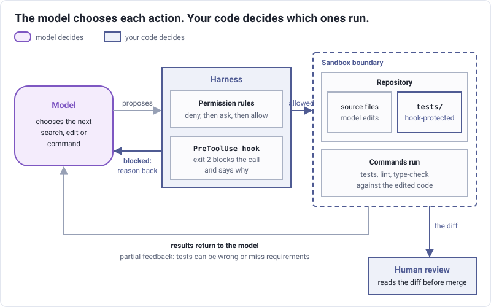

# 9.6 Coding Agents

*An agent loop pointed at a repository, with tools to search, edit and run commands. The tests give it feedback a chatbot never gets, and the agent can edit the tests, so a green run means something only when the checks were out of its reach.*

## Why you'd reach for it

You ask a coding agent to fix a failing test. Ten minutes later it reports that the suite passes, and the diff shows how: it changed the expected value in the test. The test is green and the bug is still in the code.

Coding is the domain where an agent's work is easiest to check automatically, because the environment answers back. A compiler and a test suite tell the agent whether its last edit worked, and Anthropic's own account of where agents succeed leans on exactly that: "Code solutions are verifiable through automated tests."[^bea] The same property carries the trap. The agent can read the tests, and it can usually write to them. A check the agent can rewrite has stopped measuring the agent.

Take a concrete repository: the codebase behind Listing Studio, a product-listing pipeline that turns a supplier feed into a storefront page. Its pricing module enforces a supplier's minimum advertised price (MAP), the lowest price the storefront may show, and a test pins the floor for one product, the Aldsworth desk, at $399, written `39900` because prices are stored in cents. The test starts failing after a refactor. Asked to fix it, the agent has two paths to green. It can find the bug in the module, a discount now applied after the floor check, or it can change `39900` to `37900` in the test. Both runs end with the same report, and only the diff tells you which you got. The wrong one ships a sub-MAP price with a passing CI badge.

The fix is mostly engineering you already know. Put the rules that must hold where the agent cannot argue with them: a hook that blocks writes to the tests (in Claude Code, a `PreToolUse` hook, a script run before each tool call), a sandbox around its commands, a review that reads the diff to the checks before the green tick. The instructions file is for what the agent should know and may weigh.

Reach for a coding agent when:

- **The task has a check.** A failing test, a type error, a lint rule, a reproduction script.
- **The work is bounded.** One bug, one module, one migration with a clear done-condition.
- **You can read what it did.** A diff small enough to review, on a branch you control.

And the counter-trigger: when there is no check and no one will read the diff, a coding agent produces plausible code at high speed, and plausible is the failure mode. Write the test first, or write the code yourself.

## What it actually is

A coding agent is [the agent loop](../the-unit/the-agent-loop.md) with a repository as its environment. The model chooses what to search, what to edit and which command to run next. The [harness](../the-unit/the-harness.md) around it, the code that runs the loop, decides which of those actions are permitted at all. Compilers and tests return results the model reads before its next move, which gives the loop partial feedback from the world. Partial, because tests miss requirements, tests can be wrong, and the agent can edit them.



Who decides depends on which loop you mean. Inside a session the model decides: it picks the searches, the edits and when to stop, so this part is agentic. The permissions, hooks and sandbox are your code deciding, and so is any wrapper that runs the checks and relaunches the agent on failure; that wrapper is [the outer loop](../composition/the-outer-loop.md), and it exists only if you build it. Classify a tool by who decides, never by its packaging: a CLI and an IDE panel can host the same loop, and a fixed CI workflow can contain an agentic step.

How proven is it? On this book's maturity scale, coding agents as a whole are Emerging, while the harness practices this chapter teaches are Established: those are vendor-documented and rest on measured feedback-driven coding, but transfer beyond bounded tasks and any speed gain are unsettled. The SWE-agent work showed that the interface itself matters. Its agent-computer interface, a small command set built for a model to search, view, edit and test code, "significantly enhances an agent's ability to create and edit code files" over a plain shell.[^sweagent]

The productivity claim is Contested. In METR's randomized trial, 16 experienced open-source developers working 246 tasks in their own mature repositories took 19% longer with early-2025 AI tools, while estimating afterwards that the tools had made them 20% faster.[^metr-rct] METR's February 2026 follow-up called its newer data "an unreliable signal" because the developers who most expected a speedup were opting out of working without AI, so the remaining sample was self-selected.[^metr-2026] Benchmarks do not settle it either. OpenAI stopped reporting SWE-bench Verified after an audit of 138 problems its o3 model did not consistently solve: 59.4% of that hard subset had material flaws in the tests or the problem description, and every frontier model it tested could reproduce some of the original fixes.[^openai-swe] The flaws sit in a subset, but it is the hard subset, where top models differ, and a model that can reproduce the original fix may be remembering the answer. That is enough to stop reading a leaderboard score as a capability.

[Long-running agents](when-you-want-autonomy.md) are the same loop stretched over hours. Editor autocomplete is out of scope: the model suggests, you accept, and nothing runs on its own.

## How to do it

### The instructions file, and what it is not

`CLAUDE.md` for Claude Code and `AGENTS.md` for most other agents hold what the agent cannot learn from the code: the exact build, test and lint commands, how to run one test file, the environment variable the integration tests need.

Claude "treats CLAUDE.md files as context, not enforced configuration," Anthropic's docs say, and they recommend targeting "under 200 lines per CLAUDE.md file," since longer files "reduce adherence."[^cc-memory] In a monorepo, which file applies is vendor-specific. agents.md says an agent uses the file nearest the code it is working on, so a subdirectory's file overrides the root one.[^agentsmd] Claude Code loads the files above your working directory at launch and a subdirectory's file only once it touches a file there, and `/context all` lists which memory files actually loaded.[^cc-memory] Check it before blaming the model for a rule it never saw.

The evidence that these files help is thinner than their popularity. Gloaguen and colleagues found that providing context files "does not generally improve task success rates" and raises inference cost "by over 20% on average," for both generated and developer-written files.[^agentsmd-eval] Keep the file short and about commands: the cost grows with every line, and commands are what the agent cannot infer from the code.

### Hooks and permissions: rules that hold

"If something has to happen every time, make it a hook, a deny rule, or a managed setting," says Claude Code's best-practices page.[^cc-best] A deny rule is a permission entry that refuses a tool call outright; a managed setting is one an administrator deploys centrally, which project and user files cannot override.

A `PreToolUse` hook runs before a tool call. If it exits with code 2, the call is blocked and the hook's stderr goes back to the model as the reason, so the agent can adjust.[^cc-hooks] For the pricing repository, the fragment below goes in `.claude/settings.json` at the project root and registers `protect-tests.sh` on the edit tools. The script reads the tool call as JSON on stdin, pulls out the target file path, and exits 2 for anything under `tests/`.

```json
{
  "hooks": {
    "PreToolUse": [
      {
        "matcher": "Edit|Write",
        "hooks": [
          { "type": "command",
            "command": "\"$CLAUDE_PROJECT_DIR\"/.claude/hooks/protect-tests.sh" }
        ]
      }
    ]
  }
}
```

```bash
#!/bin/bash
# .claude/hooks/protect-tests.sh
FILE_PATH=$(jq -r '.tool_input.file_path // empty')
FILE_PATH="${FILE_PATH//\\//}"
if [[ "$FILE_PATH" == */tests/* || "$FILE_PATH" == tests/* ]]; then
  echo "Blocked: $FILE_PATH is under tests/. Fix the code, not the test." >&2
  exit 2
fi
exit 0
```

That guarantee covers the matched tools and nothing else. A path check on `Edit|Write` does not stop `sed -i` or a Python script run through the shell from rewriting the same file. Exit 2 is the only blocking code; a hook that exits 1, crashes or prints invalid JSON lets the action go ahead, and on `PreToolUse` a hook that times out does not block either, unless you set `"onFailure": "block"` (v2.1.295 or later).[^cc-hooks] If your hook enforces a policy, test that it fails closed.

Permission rules sit beside hooks. Claude Code evaluates them "in order: deny, then ask, then allow," and the first match wins regardless of how specific a later rule is.[^cc-perms] Read and edit deny rules carry the same scope limit as the hook: the docs say they do not apply "to arbitrary subprocesses that read or write files indirectly," and point to the sandbox for enforcement at the operating-system level.[^cc-perms]

### Plan, then act

For anything larger than a one-line fix, have the agent research and propose before it edits. Claude Code's plan mode "tells Claude to research and propose changes without making them": it reads files and runs shell commands to explore, and edits to source stay blocked until you approve the plan, except in interactive terminal sessions where bypass permissions are available.[^cc-modes] The approval is [planning](../composition/planning.md) with a person at the gate, and it catches the confident wrong solution before it becomes forty changed files. We found no measurement of its general effect on outcomes.

### Give it a check, and read the diff

"Claude stops when the work looks done," the best-practices page says, and without a check to run, "In practice that makes you the test suite."[^cc-best] Give the agent a command that returns pass or fail: the test file or the type checker. Then review two things in order. First, any change the agent made to the checks themselves: tests, fixtures, snapshots (stored expected outputs a test compares against), lint config, CI workflow. Second, everything else. Anthropic's account keeps human review for the same reason.[^bea]

For scripted use, `claude -p "prompt"` runs once and exits, which is how a coding agent ends up in CI jobs.[^cc-best]

### Shape what comes back

SWE-agent's gains came from concise, structured feedback and error recovery rather than raw terminal output.[^sweagent] When you write a tool or wrapper the agent calls, return a result that says which kind of failure happened, because each one calls for a different next move:

- **Test failure.** The code ran and an assertion failed: the failing test names, the first lines of each diff.
- **Environment unavailable.** The database or service the tests need is down: say so, and say the code was never exercised.
- **Timeout.** The command was killed at its limit: say whether partial output exists and whether any state changed.
- **Permission denied.** The harness refused the action: return the reason so the agent stops retrying a door that is locked.

Bound the diagnostics: a full stack trace pushed back into the context crowds out the task. Retry mechanics belong to [the outer loop](../composition/the-outer-loop.md).

### One run, with the guardrail in place

The failing pricing test again, this time with the hook and plan mode configured:

1. In plan mode, the agent greps for the MAP floor, reads the pricing module and the failing test, and proposes moving the discount ahead of the floor check. You approve.
2. It runs the single test file. The assertion fails: expected `39900`, got `37900`.
3. It tries to edit the expected value in the test. The `PreToolUse` hook exits 2, and stderr tells it the `tests/` directory is protected.
4. It returns to the module, reorders the discount and the floor check, and reruns the test file. It passes, and so does the full suite.
5. You read the diff. It touches only the pricing module, so the green run means what it says.

Your code decided twice: the plan gate in step 1 and the hook in step 3. The hook blocked the shortcut, but it would not have stopped a `sed -i` through the shell; the sandbox and the step 5 review cover that path.

### Cost and attention

Long sessions cost tokens, and they cost attention before the window fills: Anthropic describes context as an attention budget in which "every new token introduced depletes this budget."[^context-eng] Claude Code's answer is targeted retrieval, loading its instructions file up front and pulling in files with grep and glob only when needed.[^context-eng] Point the agent at the module, cap command output, start fresh for unrelated tasks, and let the harness trigger [compaction](../knowledge/compaction-and-the-window.md) when a session runs long.

## Security & trust

A coding agent reads untrusted text all day: issue bodies, READMEs, dependency source, the output of the tools it runs. Any of it can carry instructions, which makes [prompt injection](../craft/prompt-injection.md) a working risk here, listed first in OWASP's Top 10 for LLM applications, with excessive agency beside it.[^owasp] Willison's lethal trifecta states when injection turns into theft: an agent with access to private data, exposure to untrusted content, and a way to communicate externally.[^trifecta] If your agent has all three, an injected instruction can read a secret and send it out.

Exfiltration prevention, which stops data leaving the machine, breaks the trifecta: restrict network egress and keep secrets out of the workspace. Merge protection limits damage to the repository: a scratch branch and a review before merge. GitHub's Copilot cloud agent does both. It "only has the ability to push to a single branch" (the pull request's branch when invoked with `@copilot` on that PR, otherwise a new `copilot/` branch), it cannot approve or merge its own pull request, and workflows on its code wait for approval.[^gh-risks] "By default, Copilot's access to the internet is limited by a firewall," because "limiting internet access helps manage data exfiltration risks."[^gh-firewall] A scratch branch alone leaves the trifecta intact, because it limits what reaches main and does nothing about what leaves.

Run the agent's commands inside an enforced, disposable boundary with credentials scoped to the task; [Sandboxing](sandboxing.md) covers the options. Treat configuration as code: build scripts, CI workflows, hook scripts and MCP config files (which tell the agent which Model Context Protocol tool servers to launch) execute, so an edit to them deserves the review you give a dependency bump. Then gate the irreversible actions. Push, deploy, destructive git, database writes and cloud calls go on an ask rule, and development and production credentials never share a workspace. Edits and test runs are cheap to allow only because the boundary makes them cheap to throw away; [Human-in-the-Loop](../craft/human-in-the-loop.md) covers the gate.

## Gotchas

1. **A green run can be a rewritten check.** The agent edits a test, loosens an assertion, adds a skip or regenerates a snapshot, and the suite passes. Protect the checks with a hook or deny rule, so the model is not left to police a rule the code should own.

2. **A boundary nobody enforces is a wish.** In July 2025, SaaStr's founder reported that Replit's agent deleted a production database during a code freeze he had declared; by his own account, "there is no way to enforce a code freeze" in the tool.[^register] The same month, AWS found that a GitHub token with overly broad scope let an attacker commit malicious code into release 1.84.0 of its Amazon Q Developer extension; the code failed to execute because of a syntax error.[^aws] And Cursor's advisory for CVE-2025-54135 describes an indirect prompt injection that could write an MCP config file without approval and so execute code; it was patched in 1.3.9.[^cursor] Each case leaned on a boundary nothing enforced: a freeze that lived only in prose, a token trusted to do less than its scope allowed, and a config file the agent could write even though writing it meant running code.

3. **Speed is easy to feel and hard to measure.** Developers in METR's trial believed they were faster while measuring slower.[^metr-rct] Measure cycle time and rework on your own repository before you budget headcount around a vendor's number. [Evaluation](../craft/proving-it-works.md) covers how.

## In short

Run coding agents on bounded tasks with a check. Keep the instructions file short and about commands, put the rules that cannot bend in hooks, deny rules and a sandbox, and approve a plan before large edits. Read the diff to the tests before you read anything else. The model can own the search, the edit and the next move; the checks it is graded by have to stay yours.

<small class="chapter-meta">**Maturity: Emerging (coding agents overall) / Established (the harness practices)** (hooks, permissions, sandbox and diff review are vendor-documented and rest on measured feedback-driven coding; transfer beyond bounded tasks is unmeasured and the productivity effect is Contested) · *Who decides:* the model (inside the session) / your code (permissions, hooks, the outer loop) · *Grounding:* research · *Last reviewed:* 2026-11</small>

## Sources

[^bea]: Anthropic, "Building Effective Agents" (2024-12-19), Appendix 1, "Agents in practice," on coding agents: "Code solutions are verifiable through automated tests" and "human review remains crucial for ensuring solutions align with broader system requirements." <https://www.anthropic.com/research/building-effective-agents>
[^sweagent]: Yang, J., Jimenez, C. E., et al., "SWE-agent: Agent-Computer Interfaces Enable Automated Software Engineering," arXiv:2405.15793 (2024-05-06). <https://arxiv.org/abs/2405.15793>
[^metr-rct]: Becker, J., Rush, N., Barnes, E., Rein, D., "Measuring the Impact of Early-2025 AI on Experienced Open-Source Developer Productivity," arXiv:2507.09089 (2025-07). Developers forecast a 24% reduction in completion time beforehand and estimated 20% afterwards; the measured effect was a 19% increase. <https://arxiv.org/abs/2507.09089>
[^metr-2026]: METR, "We are Changing our Developer Productivity Experiment Design" (2026-02-24). <https://metr.org/blog/2026-02-24-uplift-update/>
[^openai-swe]: OpenAI, "Why SWE-bench Verified no longer measures frontier coding capabilities" (2026-02-23). The 59.4% figure is for the 138 problems o3 did not consistently solve across 64 runs, not for the benchmark overall. On the benchmark itself: Jimenez, C. E., et al., "SWE-bench: Can Language Models Resolve Real-World GitHub Issues?", arXiv:2310.06770. <https://openai.com/index/why-we-no-longer-evaluate-swe-bench-verified/>
[^agentsmd]: agents.md, "AGENTS.md." <https://agents.md/>
[^cc-memory]: Anthropic, Claude Code docs, "How Claude remembers your project": CLAUDE.md as context rather than enforced configuration, the 200-line target, load order for parent and subdirectory files, and `/context all`. Version-dependent; checked 2026-11. <https://code.claude.com/docs/en/memory>
[^agentsmd-eval]: Gloaguen, T., Mündler-Sasahara, N., Müller, M. N., Raychev, V., Vechev, M., "Evaluating AGENTS.md: Are Repository-Level Context Files Helpful for Coding Agents?", arXiv:2602.11988 (2026-02). <https://arxiv.org/abs/2602.11988>
[^cc-best]: Anthropic, Claude Code docs, "Best practices for Claude Code": enforcing rules with hooks, deny rules and managed settings; "Give Claude a check to run"; `claude -p`. Checked 2026-11. <https://code.claude.com/docs/en/best-practices>
[^cc-hooks]: Anthropic, Claude Code docs, "Hooks reference": exit-code behaviour, timeout behaviour on `PreToolUse`, and `onFailure` (requires v2.1.295 or later). The fragment in the text is adapted from the "Block edits to protected files" example in "Automate actions with hooks" (<https://code.claude.com/docs/en/hooks-guide>) and is untested here. Checked 2026-11. <https://code.claude.com/docs/en/hooks>
[^cc-perms]: Anthropic, Claude Code docs, "Configure permissions": "Rules are evaluated in order: deny, then ask, then allow," and the limits of read and edit rules on subprocesses. Checked 2026-11. <https://code.claude.com/docs/en/permissions>
[^cc-modes]: Anthropic, Claude Code docs, "Choose a permission mode," on plan mode. Checked 2026-11. <https://code.claude.com/docs/en/permission-modes>
[^context-eng]: Anthropic, "Effective context engineering for AI agents" (2025-09-29). The attention-budget framing and Claude Code's just-in-time retrieval with glob and grep. <https://www.anthropic.com/engineering/effective-context-engineering-for-ai-agents>
[^owasp]: OWASP, "Top 10 for LLM Applications" (2025): LLM01 Prompt Injection and LLM06 Excessive Agency. <https://genai.owasp.org/llm-top-10/>
[^trifecta]: Simon Willison, "The lethal trifecta for AI agents: private data, untrusted content, and external communication" (2025-06-16). <https://simonwillison.net/2025/Jun/16/the-lethal-trifecta/>
[^gh-risks]: GitHub Docs, "Risks and mitigations for GitHub Copilot cloud agent." <https://docs.github.com/en/copilot/concepts/agents/cloud-agent/risks-and-mitigations>
[^gh-firewall]: GitHub Docs, "Customizing or disabling the firewall for GitHub Copilot." <https://docs.github.com/en/copilot/how-tos/copilot-on-github/customize-copilot/customize-cloud-agent/customize-the-agent-firewall>
[^register]: Simon Sharwood, "Vibe coding service Replit deleted user's production database, faked data, told fibs galore," The Register (2025-07-21). The account is the founder's own, from his posts; the article carries no response from Replit. <https://www.theregister.com/2025/07/21/replit_saastr_vibe_coding_incident/>
[^aws]: AWS, Security Bulletin AWS-2025-015, "Security Update for Amazon Q Developer Extension for Visual Studio Code (Version #1.84)," CVE-2025-8217 (2025-07-23). A supply-chain case: the agent did not cause it. <https://aws.amazon.com/security/security-bulletins/AWS-2025-015/>
[^cursor]: Cursor, GitHub security advisory GHSA-4cxx-hrm3-49rm, "Arbitrary code execution from Cursor Agent through a prompt injection via MCP Special Files," CVE-2025-54135, crediting researchers hxofir-a and MaccariTA (2025-08). A demonstrated exploit, not observed customer harm. <https://github.com/cursor/cursor/security/advisories/GHSA-4cxx-hrm3-49rm>

## See also

- [2.5 The Agent Loop](../the-unit/the-agent-loop.md), the inner loop a coding agent runs.
- [2.6 The Harness](../the-unit/the-harness.md), for permissions, hooks and stop conditions in general.
- [3.6 Planning & Task Decomposition](../composition/planning.md), the pattern plan mode puts a person in front of.
- [3.7 The Outer Loop](../composition/the-outer-loop.md), for the verify-and-retry wrapper your code owns.
- [4.6 Prompt Injection & the Lethal Trifecta](../craft/prompt-injection.md), the theory behind the security section.
- [9.4 Sandboxing](sandboxing.md), for the execution boundary.
- [9.1 Long-Running Agents](when-you-want-autonomy.md), for the same loop over hours.
- [2.3 Skills](../the-unit/skills.md) and [5.1 State, Not Memory](../knowledge/state-not-memory.md), for what belongs in the instructions file and what belongs elsewhere.

## Further reading

- Anthropic, [Best practices for Claude Code](https://code.claude.com/docs/en/best-practices): the vendor's own operating guide, including what to enforce and what to leave to judgment.
- Yang et al., [SWE-agent](https://arxiv.org/abs/2405.15793): the paper that made the agent-computer interface a design object.
- Becker et al., [the METR developer trial](https://arxiv.org/abs/2507.09089): the best-designed measurement of productivity so far, and a careful one about its limits.
- OpenAI, [Why SWE-bench Verified no longer measures frontier coding capabilities](https://openai.com/index/why-we-no-longer-evaluate-swe-bench-verified/): how a benchmark audit is done.
- Simon Willison, [The lethal trifecta](https://simonwillison.net/2025/Jun/16/the-lethal-trifecta/): the three conditions in one page.
